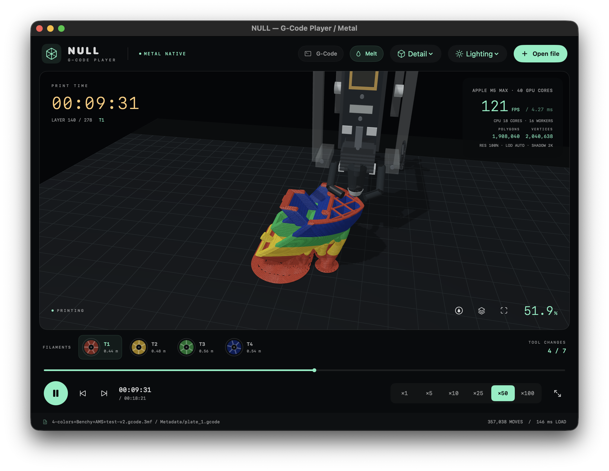
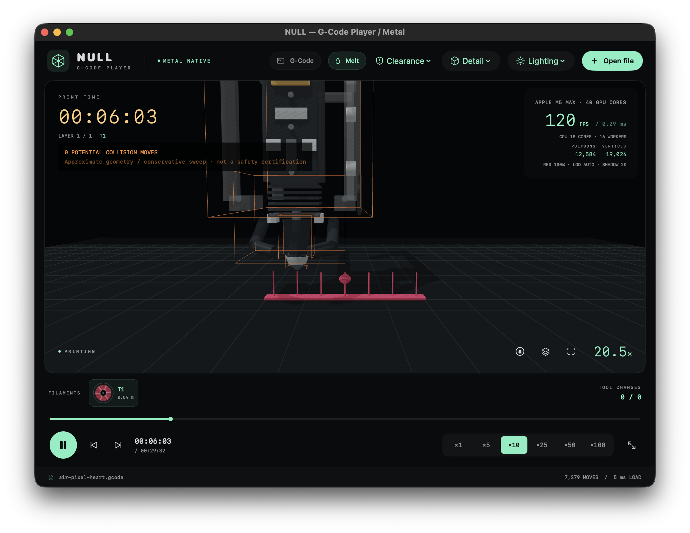

# NULL G-Code Player for macOS — v0.10

A native Swift + Metal G-Code player, built for fast local previews on Apple Silicon. No WebView, browser, Electron, or JavaScript runtime is involved.

This is the independent native implementation of [NULL G-Code Player](https://github.com/GOROman/null-gcode-player), focused on rendering speed. Karaoke, music synchronization, pachislot cut-ins, automatic race cameras, and mechanical tool docking from the web version have not yet been ported.



## Download

Download the Apple Silicon app from the [v0.10 release](https://github.com/GOROman/null-gcode-player-macos/releases/tag/v0.10), unzip it, and move **NULL G-Code Player.app** to Applications. Requires macOS 14 or newer. The release is ad-hoc signed and is not notarized.

## Build and launch

Requires macOS 14 or newer, a Metal-capable Mac, and the Swift tools from Xcode or Command Line Tools. No third-party dependencies are required. Builds run on the host architecture; Apple Silicon is the tested target.

```sh
./scripts/build-app.sh
open "build/NULL G-Code Player.app"
```

The app is signed locally with an ad-hoc signature. This is a local development build, not a notarized distribution.

Choose **Open**, press **⌘O**, or drop a `.gcode`, `.gco`, `.gc`, sliced `.3mf`, or `.zip` file. Archives open their first naturally sorted G-Code plate. Unsliced projects are rejected with an explanation.

## Controls

- Play / pause: **Space**. Playback speeds: **×1, ×5, ×10, ×25, ×50, ×100**.
- Step to the next motion: **Right arrow**. Drag the timeline to seek; restart returns to zero.
- Drag to orbit; scroll to zoom; right-drag to pan. **Top** and **Fit** reposition the camera. **F** toggles fullscreen.
- **G-Code** shows a readable green live source overlay with a brighter current line. The charcoal interface uses custom playback controls, a draggable timeline, compact telemetry, and filament spool cards.
- **Melt** adds a smooth meniscus at the active nozzle, spreads the fresh bead into neighboring strands, and leaves expanded contacting profiles as material cools. Gloss follows the deposition time at each point along a line, rather than changing the whole line at once. Travel and retraction moves emit no meniscus. The **drop-circle** control follows the nozzle for close inspection; orbit, pan, Top, or Fit exits tracking. This is a visual approximation of deposition and fusion, not a thermal or fluid solver or a boolean mesh union. Filament remains individually instanced on the GPU.
- **Lighting** contains the shadow toggle and 1K / 2K / 4K shadow-map settings. The default paused map is 2048²; moving views use half the selected size. Light-space bounds fit the model, plate, and head, with texel-scaled depth bias. Lighting includes a key light, ambient fill, rim lighting, and specular highlights.
- Filament colors come from Bambu Studio's `filament_colour` / `filament_color` metadata and `T` tool commands. Filament spool cards show each used material and highlight the active tool. Spokes rotate proportionally to cumulative G-Code extrusion, with meters used per tool. Consumption follows relative/absolute E, inch units, G92, arcs, pause and seeking; unretraction is not counted twice. The rotation uses a nominal 90 mm winding radius and does not estimate remaining spool mass. Extruder-only purge commands outside timed motion are not included. **TOOL CHANGES** shows the current and total logical change counts, including when seeking backward or forward; switches without subsequent extrusion are consolidated. Unknown tool colors use a fallback, without wrapping into another tool's color.
- The upper right shows the actual Metal device, the GPU core count reported by macOS, available CPU cores, preparation workers, FPS, GPU command time, triangle count (**POLYGONS**), and submitted vertex count (**VERTICES**). Geometry counts include the plate and head, follow playback and distance-based detail changes, and exclude shadow-pass redraws. For indexed beads and the meniscus, vertex count reports distinct referenced vertices per instance; unindexed meshes report submitted vertex references. Actual shader invocation counts depend on the GPU vertex cache. An unavailable GPU core count is shown as `—`; it is not guessed from the chip name. Core count indicates hardware capacity, not measured utilization.

The parser handles absolute/relative XYZ and extrusion, G92, millimeters/inches, tool commands, Bambu layer/width/height comments, XY G2/G3 arcs (I/J or R), and full circles. Non-XY arcs currently fall back to straight moves. The preview clock uses commanded feedrates, without firmware acceleration, heating, or dwell estimates.

## H3C-style toolhead

The head is a lightweight procedural Metal mesh: open translucent carriage frame, dark detachable PrintTool, orange latch surround, contact pads, cooling fins, side fan, silicone sock, polished shoulder, and a fine nozzle tip. The inlet filament takes the active tool color. Opaque metal and translucent parts are rendered separately and cast shadows.

The shape uses the supplied PrintTool photograph and the web player's documented H3C calibration as visual references. It is an approximation, not manufacturer CAD. The nozzle outlet stays at the toolpath position. See the [Bambu PrintTool product page](https://us.store.bambulab.com/products/0-4mm-printtool-h3c) for the actual hardware.

For a close view, launch with a sample path followed by `--head-preview`. Add `--show-code` to initially display the live source overlay.

## Performance design

- State-dependent G-Code parsing runs off the main thread. Geometry preparation uses up to 16 CPU workers, leaving two logical cores available where possible.
- Workers fill disjoint ranges of shared Metal buffers directly. The buffer is published to the renderer only after all workers finish.
- Each extrusion uses 64 bytes of instance data. Bead geometry is generated in the vertex shader, rather than expanded into CPU vertex meshes.
- Completed geometry stays resident on the GPU. Seeking performs binary searches; playback updates small uniform values rather than rebuilding the model.
- The renderer requests 120 FPS, uses 4× MSAA, and limits commands in flight to three. Actual FPS depends on the display, model size, resolution, and enabled effects.
- **Detail** selects Automatic, High, Balanced, or Fast geometry. Automatic LOD evaluates projected bead width separately for each 256-run block. Close blocks use rounded beads (32 triangles), middle blocks use simplified solid beads (16 triangles), and distant blocks use screen-facing elliptical ribbons (two triangles). Hysteresis reduces switching at the thresholds. The active nozzle block stays detailed in Automatic mode. The projected width accounts for the flattened cross-section. Shadow maps use crossed ribbons independently of the main-view LOD.
- Opaque plate and filament rendering disables alpha blending so Apple GPUs can reject hidden fragments before shading. Only the translucent head uses blending.
- Conservative bounds for blocks of 256 runs allow CPU frustum culling. Adjacent visible blocks are submitted as a single range; when the whole model is in view, the single-draw fast path is retained. Offscreen geometry can still cast shadows.
- Continuous collinear extrusion moves with the same tool, layer, dimensions, and feedrate are compacted into one GPU run. Travel moves, corners, speed changes and material boundaries prevent merging. Original source motion stays intact for playback, head movement and Step. This does not replace arbitrary cooled layers with a new surface or discard internal geometry.
- During playback or camera movement, shadows use half the selected map resolution, a cheaper filter and at most 30 updates per second. Pausing restores the selected resolution and nine-tap filter. Close paused views also use the detailed bead geometry in the shadow pass.
- Sustained GPU pressure during motion reduces drawing resolution in bounded steps, down to 70%; lighter workloads restore it gradually. A stationary paused view restores full resolution. **RES** shows the current scale. Benchmarks always use full resolution for comparable geometry workloads.
- Indexed procedural geometry reuses shared vertices: a detailed bead references 34 vertices for 32 triangles; a balanced bead references 18 vertices for 16 triangles; a distant ribbon uses four vertices for two triangles; the meniscus uses 114 vertices for 224 triangles. Fully closed bead caps prevent hollow ends in close views. The low-detail shadow caster is inscribed in the bead profile to reduce false self-shadowing.
- Frustum and LOD plans are cached until the camera matrix, visible run count, render height, detail mode, nozzle-protection state, or loaded model changes.
- UI updates and GPU telemetry are throttled independently of rendering.

## Checks and measurements

```sh
# Parser checks (works with Command Line Tools; no XCTest dependency)
./scripts/check.sh

# Also compile the Metal shader on a real GPU
NULL_TEST_GPU=1 ./scripts/check.sh

# Parse/archive benchmark
swift build -c release
.build/release/gcode-benchmark /path/to/sample.gcode.3mf

# Full-model rendering benchmark: prints results after 180 measured frames
open -n --stdout /tmp/null-metal.log --stderr /tmp/null-metal-errors.log \
  "build/NULL G-Code Player.app" --args /path/to/sample.gcode.3mf --benchmark
```

The `--benchmark` option shows the complete print and measures actual Metal command-buffer GPU time after warmup. Measurements include the main render pass and shadow updates when they occur. It does not imply feature parity with, or a controlled speed comparison against, the web renderer.

The bundled checks cover relative extrusion, G92, relative coordinates, inch conversion, XY arcs, full circles, radius arcs, Bambu metadata, tool changes, boundary seeking, empty files, conservative run compaction, six-plane frustum culling, partial visibility ranges, adaptive-quality recovery, tool-change counters, per-tool filament consumption and retractions, H3C mesh layout and finite normals, indexed-surface closure and nondegenerate triangles, distance-based LOD selection, hysteresis, nozzle protection, detail overrides, and optional real-GPU shader compilation. Sample print files are local inputs and are not committed.

## Layout

- `Sources/GCodeCore`: parser, archive loading, source and motion data.
- `Sources/GCodePlayer`: SwiftUI controls, Metal view, parallel preparation, and rendering.
- `Sources/GCodePlayer/Shaders`: bead generation, melt appearance, lighting, grid, and shadows.
- `Sources/GCodeBenchmark`: command-line parsing benchmark.
- `Tests/GCodeCoreTests`: standalone checks, usable without XCTest.

Created by GOROman.


### Nonplanar air-pixel experiment and head clearance



`samples/air-pixel-heart.gcode` is a **preview-only**, anchored, vertical 27-pixel
heart. Generate it with `python3 scripts/generate-air-pixels.py`. All seven stems
grow in 0.3 mm height bands; transfers lift above the current maximum height.
The previous column-first path is retained as
`air-pixel-heart-unsafe-columns.gcode` strictly as a collision regression fixture.
Neither file is a validated H3C print job. Startup/heating sequences are absent;
cooling dwell values are illustrative, and the viewer does not simulate dwell,
cooling, sagging, strength, or the physical feasibility of the coiled beads.

Use **Clearance → Check deposited-material clearance** for a background check.
Orange wire boxes show approximate nozzle shoulder, sock, duct, carriage and
upper-tool envelopes relative to the moving head. The overlay reports potential
contact movements and their source lines; the menu can jump to the next one.
Checking initially seeks the first flagged movement. `--check-clearance` starts
this check on load; `--front-preview` opens the completed model from the front.

The checker indexes previously deposited segments in a bounding-volume hierarchy
and tests conservative swept head boxes, including travel and descent. Filament
bounds include a width/height allowance. Future material is excluded. Diagonal
sweeps and solid boxes around open parts may produce false positives. The outlet's
immediate deposition zone is excluded. This is **not certified collision detection**:
it uses the visual reconstruction rather than manufacturer CAD, excludes gantry,
bed, fixtures and deformations, and does not check a move against its own freshly
extruded material. A zero count is not proof that a job can be printed safely.

The regression checks find 2,930 potential contact movements in the column-first
fixture and zero in the height-ordered version under these same approximations.

### Experimental filament failure (Moja)

The **モジャ** button switches subsequent extrusion to a bounded rope simulation.
**Environment** adjusts simulated nozzle/plate/ambient temperature, humidity,
cooling fan and relative PLA viscosity. These are local visual controls, not
printer commands. The PLA model uses an illustrative temperature-dependent
viscosity and exponential cooling curve; it is not calibrated rheology. Initial
210 °C nozzle temperature is consistent with [Prusament PLA guidance](https://prusament.com/wp-content/uploads/2022/10/PLA_Prusament_TDS_2021_10_EN.pdf),
but solver coefficients are artistic approximations. Cold strands retain their
shape, and each emitted strand retains its original filament color.

Metal compute projects nonadjacent segment contacts in parallel, using four
Jacobi passes and asynchronous readback. Integration and constraints remain on
the CPU. The solver retains up to 1,200 particles and retires the oldest when
necessary so extrusion continues. Existing printed material is approximated by
a 1 mm top-surface height map; cavities, undersides, rigid-body peeling and
continuous collision detection are not modeled. Extremely fast motion may still
cause penetration. No claim of physically predictive failure simulation is made.
